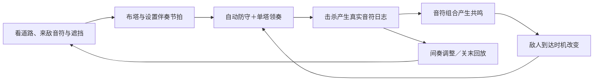

# 《夜之乐章》PRD：用防线演奏音乐

版本：0.1 · 评审稿  
日期：2026-10-11  
面向：策划、主程序、关卡、美术、音频  
平台：Windows；团结引擎；鼠标＋键盘  
目标：用于 TapTap GameJam「涌现」主题的可完成版本。本文提出待验证的产品方案，不代表功能已经实现或体验已经成立。

地图修订（2026-10-11）：用户明确要求道路与附件相同。以四张单区图片为准，逐格保留道路、障碍和基地；实测每区 25×13，总图 50×26。见[地图对位稿与数据](../art/2026-10-11/map-layout-v0.2/README.md)。本次修订固定地图，不表示用户已经批准本文其他战斗规则建议。

## 1. 产品结论

**玩家布置一支能够自动防守的乐队，并亲手演奏其中一个声部；音符来自敌人，旋律来自拦截顺序，音乐组合又改变下一段战局。**

推荐采用「自动伴奏＋单塔领奏」：自动塔维持防线与基础节奏，玩家选择一座钢琴塔接管，用三个起步音键选择接下来响起的音符，留白也是有效操作。与塔的位置、攻击节拍和敌人到达时间结合，形成不同的防守与音乐结果。

首版要证明三件事：

1. 玩家能指出“刚才这几个音是我选的”，并再次演奏出来。
2. 玩家要在“马上处理危险敌人”和“等到合适节拍组织音乐”之间取舍。
3. 同一波敌人能被不同布局与指挥方式演奏成不同结果，结果还能反馈到战场。

最重要的制作顺序是：先验证一条路上的 16 拍领奏，再做四区域内容。单靠更换音源、增加乐器、随机出音，无法证明上述体验成立。

## 2. 依据、继承与设计修订

### 2.1 本次依据

- [S1：4.关卡搭建文档](https://my.feishu.cn/wiki/I1XuwlIWyisXaIk2K9OcA3qNnwe?blockId=DcyDdSR4zoMJKbx3TQpcSOYYnzb&blockToken=JzABw1QVlhzVaFbk0aZcy0eVnUf&blockType=whiteboard&doc_app_id=501)：已查看地图总览、图例、攻击范围图与限制文字。旧文字标注 14×25，但用户本次提供的四张单区图片实测为横 25、纵 13，以附件为准。四区共用中央基地；草地、道路、阻隔、基地分色，地块美术标注 64×64。
- [S2：3.核心系统与世界观逻辑文档](https://ecnwdqoebhjp.feishu.cn/docx/WWnWdA5cqoICMtxcAJQccJgRnyg?blockId=F3I5dYsv1o1i2Axj70vcuQ0nnwd&blockToken=KcCIwcdtyhnR3GbLuuvc5vbpnpd&blockType=whiteboard&doc_app_id=501)：已查看基础机制、建造流程、四关镜头流程，以及普通／和弦塔与敌人分组。
- 当前本地工程：已有钢琴采样、节拍驱动模拟、音高筛选、攻击节拍预设、击杀记谱、共鸣和回放。现有棋盘仍是三条直路；其四个教学关不等于 S1 的四块空间。
- 仓库旧版系统设计仅作为背景；本 PRD 优先回应本次两份飞书图。旧版的白天探索、五类乐器和 Boss 不自动进入本次范围。

### 2.2 保留的方向

保留节拍推进、网格地图、据点生命、敌人携带音高、塔提供音色、击杀发声、按格建造，以及四区共用一个基地、按顺序推进、最终拉远镜头的演出结构。

### 2.3 需要团队明确接受的修订

以下均为本文建议，不是飞书原文已确定的要求。

| 原方案或差异 | 本 PRD 的推荐规则 | 原因 |
|---|---|---|
| 普通塔只打普通敌人；和弦塔只打和弦敌人 | 改为有明确效率差异的软克制，详见第 6 节 | 保留临场补救与跨塔协作，避免只剩类别配对 |
| 攻击范围不重合，且范围内不能放新塔 | 允许射程重叠；同格禁止重复建造；预设建造位控制密度 | 两座塔必须能争抢或配合同一批目标，才有编排空间 |
| S2 写普通塔 3×3、和弦塔 5×5；S1 的和弦范围图为菱形格覆盖 | 首版将 S2 的尺寸解释为方形 3×3／5×5；射程模板做成资源，可另测 S1 图形 | 尺寸文字本身不能确定格子形状；这是本文的统一建议，不是原稿已消除歧义 |
| 原图普通音色是班卓琴、铃铛，和弦音色是小提琴 | 首轮验证沿用现有钢琴；通过后加一个和弦音色，小提琴优先 | 延续此前“先用钢琴”的开发基础，把输入体验先测清楚 |
| 自动切关、不展示结算 | 保留连续镜头与音乐；加入可跳过的短间奏整备 | 给玩家重布阵与理解新规则的时间 |
| 基础图的漏怪描述涉及扣最大生命 | 扣当前生命，最大生命保持 10 | 避免永久惩罚与恢复规则冲突 |

单区地块已按本次附件保存为逐格数据。入口启用、行进方向、波次与塔位仍需配置；不能把所有贴边道路自动当作出生点，也不能把地图占格数据当作已验证的波次表。附件 7 明确普通范围为 3×3，和弦范围为 1／3／5／3／1 菱形；本文对范围、重叠和软克制的其他设计仍是待评审建议。

## 3. 体验定位与备选方案

| 方案 | 玩家感受 | 主要风险 | 采用结论 |
|---|---|---|---|
| 自动伴奏＋单塔领奏 | 我布置乐队，同时亲手挑选关键音与休止 | 需要把按键、目标、发声时机解释清楚 | **推荐** |
| 全自动编曲塔防 | 我设计了一个会演奏的机关 | 演奏感偏间接，容易变成布好后等待 | 作为辅助模式与保底玩法 |
| 标准下落式音游＋塔防 | 我打谱获得火力 | 同时看谱与看地图；曲子固定后，音乐的作者感减弱 | 本次不采用 |

目标玩家无需识谱。第一关只用 Do、Mi、Sol，分别显示唱名、颜色、形状和按键，不能只靠颜色区分。先让玩家听出重复、留白、合奏，再引入术语。

单次完整体验暂定 6–10 分钟，四个区域逐步教学；这是内容调试目标，不是从当前地图尺寸推算出的保证。通关只要求基地存活，音乐挑战用于获得额外战术收益与个人演出记录。

## 4. 核心循环与操作

### 4.1 状态流程

| 阶段 | 玩家操作 | 系统行为 |
|---|---|---|
| 开场全览 | 开始／跳过 | 展示四区和中央基地，约 3 秒；落到第一关 |
| 整备 | 放置、回收、试听、设置节拍、指定领奏塔 | 战斗时间停止；提供路径与波次预览；玩家主动开始 |
| 演奏 | 领奏、切回自动、查看范围、预约节拍修改 | 敌人与自动塔按拍运行；实时展示下一可演奏拍 |
| 小段间奏 | 使用本段获得的币建造／回收／重布置 | 暂停战斗状态，循环低音量过渡音型；按继续从下一个完整小节开始 |
| 区域完成 | 查看一句反馈、继续／回放本区 | 保留基地状态，镜头平滑移到下一块；不弹长结算页 |
| 全曲完成 | 聆听、重试任一区、返回标题 | 全览四区，按实际日志顺序演出整局音乐 |

战斗中首版允许节拍、筛选和领奏切换，建造与回收集中到整备／间奏，减少玩家同时弹奏和操作小按钮的压力。暂停冻结战斗与音乐播放位置；恢复有一拍倒计时，之后接回同一逻辑位置。

### 4.2 按键与鼠标

| 输入 | 行为 |
|---|---|
| 左键点建造位 | 打开周边小型建造选择；再点塔卡确认 |
| 左键点已有塔 | 显示范围、节拍、音高筛选及“设为领奏” |
| A / S / D | 领奏 Do / Mi / Sol；屏幕琴键有同等入口 |
| R 或“自动／领奏”按钮 | 已指定的领奏塔在两种模式间切换 |
| 空格 | 开始／暂停／继续；全局只响应一次 |
| Esc | 关闭局部面板；无面板时打开暂停 |

七音 A–J 键位仅列为后续扩展；第一份体验验证不需要七键。

## 5. 演奏感：一座塔，一条可看见的因果链

### 5.1 自动声部

自动塔有四种一眼可见的四拍模板：`●●●●`、`●·●·`、`·●·●`、`●···`。所有模板从关卡统一拍号计算，中途建塔或修改设置不重置全局相位。第一关只开放每拍，后续逐步开放其他模板。

默认自动索敌为最接近基地、且满足筛选的目标；危险程度相同按生成编号稳定排序。进阶选项保留“全部／只弹某音／跳过某音”，避免首屏同时展示全部参数。

### 5.2 手奏声部

同一时间只能有一座钢琴塔处于领奏模式。它仍受原位置、射程、遮挡与每拍最多一次攻击的限制。领奏模式使用每拍一次的攻击机会，其他节拍模板暂时锁定；退出后恢复原自动模板。

玩家按音键，预约下一**尚未锁定**的整数拍攻击该音高的敌人。执行时，优先选中可一击击杀的同音普通敌人；它的死亡播放钢琴音色。玩家不按键，这座塔在该拍休止；其他塔继续自动防守。

主动演奏的收益是**选择目标与时机**：自动塔可能先处理 Sol，玩家可以先弹 Mi，再把 Sol 留到合奏拍。其代价是放弃立即清除最近威胁的机会。手奏不额外增加射程、攻击次数、金币或伤害，音乐反馈承担它的战术价值。

普通塔可以缓慢拆解和弦敌人，但首版领奏仅接受普通敌人目标，确保有效点奏一定产生一个击杀音。UI 明确标识和弦敌人由自动塔或和弦塔处理，不让玩家把无声削甲误认为按键失效。

### 5.3 输入契约

1. 每个未锁定的待执行拍只有一个领奏音符槽；再次按键覆盖该槽，长按不连发。同一帧多个新按键按固定键序取最后一个，并高亮最终选择。
2. 按下当帧就亮琴键、显示待演奏唱名和目标拍；真正的战斗音在预约拍播放。尚未执行的音符用空心点，实际击杀改为实心点。
3. 先计算该拍敌人移动后的预计位置，再提示某个音是否可命中。执行时领奏攻击优先于自动攻击，避免被自动塔抢走已提示的目标。
4. 若执行时无合格目标，则休止，不乱选别的音，也不凭空制造音符；显示“已离开范围／被阻隔／没有该音目标”的具体原因。
5. 模式切换与节拍修改在未锁定拍边界生效；已经安排播放的音不撤回。切换领奏塔只清除旧塔尚未锁定的预约；暂停清除可编辑预约、保留已锁定拍，重开／切区清空全部临时状态。
6. 这是有预告的按拍演奏。100 BPM 时一拍 600 ms，输入等待可能接近一拍；预调度锁定期暂按 80 ms 作为验证起点，UI 必须显示真实可输入的拍，不能把已锁定的拍标成可操作。

**首要风险：**预约下一拍可能让玩家觉得迟钝。先测 16 拍小样；若因果清楚但等待感明显，单独验证八分音符输入与更短调度窗口，保持每整拍最多一次攻击。这个备选涉及模拟时间粒度改动，不能当成调一个 UI 数字即可完成。若仍不成立，缩回“声部进入／休止”的指挥玩法，并相应调整产品定位。

### 5.4 一段可玩的例子

以下是供关卡设计构造的情境，不是已验证的波次脚本：

| 拍 | 可见情况 | 玩家选择 | 可听见与可看见的结果 |
|---|---|---|---|
| 1 | Do、Mi、Sol 分别即将进入可见范围 | 预约 Do | Do 敌人被钢琴击杀，琴键和谱点同时亮 |
| 2 | Mi 较危险，Sol 后到 | 预约 Mi | 听到第二音；防线仍安全 |
| 3 | Sol 可立即击杀；另一声部下一拍才准备好 | 留白 | 敌人前进一格，音乐出现休止，漏怪风险增加 |
| 4 | 自动声部预计发出 Do、Mi，Sol 仍在领奏射程 | 预约 Sol | 三个音形成和弦，触发一次共鸣；存活敌人的下一次移动被延后 |

另一种合法解法是第 3 拍直接击杀 Sol，拿到更稳妥的防守结果。这两种解法都能通关，听起来不同，后续敌人位置也不同。

## 6. 塔、敌人与塔防取舍

以下数值是首轮调试起点，统一放在配置资产中；不作为未试玩前的平衡结论。

### 6.1 两种规则角色

| 项目 | 普通琴塔 | 和弦塔 |
|---|---|---|
| 验证音色 | 钢琴 | 先用钢琴和弦验证；交付优先替换小提琴 |
| 覆盖 | 以塔为中心 3×3 方形 | 以塔为中心 5×5 方形 |
| 常规攻击 | 每个启用拍选一名敌人，伤害 1 | 每四拍第 1 拍攻击一次 |
| 主目标 | 普通敌人 | 范围内至多 3 名和弦敌人，各伤害 3 |
| 跨类型处理 | 无普通目标时，可以对和弦敌人造成 1 伤害 | 无和弦目标时，只攻击最近的 1 名普通敌人，伤害 1 |
| 初始造价 | 8 币 | 16 币 |
| 决策作用 | 保底点杀、领奏、节拍填充 | 处理成团压力、提供较稀疏的和声 |

和弦塔每次攻击采用一种目标分支，不同时清普通和和弦敌人。普通塔、和弦塔都不能穿过阻隔。允许射程相交，但相交区域会发生目标竞争；重叠是否有价值取决于节拍和筛选搭配。

班卓琴与铃铛先作为未来普通声部的音色选项，避免第一版做两套近乎相同的战斗系统。更换音色不自动改变伤害。

### 6.2 三种敌人

| 敌人 | 生命／移动 | 被击杀的音乐 | 引入目的 |
|---|---|---|---|
| 单音敌人 | 1；每拍 1 格 | 自身一个音高 | 让“选择敌人＝选择音符”直接可懂 |
| 快速单音敌人 | 1；每拍 2 格 | 自身一个音高 | 改变到达次序，让等拍有风险；从第三关少量出现 |
| 和弦敌人 | 3；每拍 1 格 | 和弦塔击杀播放配置的三音；普通塔击杀只播放其根音 | 让专用塔有价值，又保留低效补救 |

普通塔对和弦敌人的非致死伤害只显示拆解反馈，不进入音乐日志。和弦敌人的多个音共享一次击杀编号，奖励金币只结算一次。普通敌人与和弦敌人漏进基地均扣当前生命 1；首版不追加不同漏怪惩罚。

### 6.3 防守乐趣来自四种取舍

- **前置与后置：**前段击杀安全，后段等待更容易与别的声部合拍，但容错更低。
- **覆盖与遮挡：**路口附近可能覆盖更多路线，墙后格子可能失去关键视线；购买前必须预览有效格。
- **分工与争抢：**两座每拍攻击的塔可能抢掉领奏目标；错开节拍或筛选音高可形成配合。
- **稠密与留白：**每拍攻击更稳，主动休止能组织乐句和共鸣，但必须承担敌人继续前进的代价。

自动防守是允许的通关方式。验收要求至少有一组情境中，精确选音／等拍能改善压力处理；也至少有一组情境中，为共鸣强行等拍会导致漏怪。这样音乐决策才有实际利弊。

## 7. 音乐系统与「涌现」

### 7.1 谁决定音乐

| 音乐维度 | 决定者 |
|---|---|
| 有哪些音可弹 | 关卡波次提供的敌人音高 |
| 谁先响 | 路线、塔位、索敌与玩家领奏选择 |
| 哪拍响、哪拍留白 | 统一拍网、自动模板与领奏输入 |
| 什么声音 | 击杀塔的音色 |
| 是否形成合奏 | 多个独立击杀事件在同一拍的组合 |
| 下一句如何变化 | 漏怪、剩余敌人、共鸣延迟与新输入 |

关卡给出音乐材料和短动机，不预先锁死唯一完成曲。M1 和首版单音敌人限定为同一音区的 C4、E4、G4，A/S/D 分别精确对应这三个音高，不混入更高八度却仍标成同一个按键。扩展音区、音阶与不同和弦是后续内容，届时需另定跨八度选择规则。

### 7.2 共鸣规则：少而明确

首版只保留一个战术共鸣：同一拍出现 Do、Mi、Sol，且来自至少两座塔和至少两个不同击杀事件，触发一次「合奏休止」。单只和弦敌人被一座塔击杀所产生的三音不会独自触发。

普通琴塔每次只发一音，因此三琴塔场景要求真正补齐缺失音；和弦塔若已奏出完整 Do–Mi–Sol，另一座塔同拍奏出三音中的任意一音即可应答。这两种情境分别教“选音”和“同拍进入”。第三关不得把后者包装成必须选中特定缺失音；手奏精确选音的价值需在普通声部场景单独验收。

效果：触发区域中当时仍存活的敌人，跳过下一拍的一次移动；新出生敌人不自动获得延迟。跳过移动期间仍可被攻击。每区域每四拍小节最多触发一次，且两次触发至少间隔四拍，避免跨小节边界连放；效果不叠加。首版不附带额外杀敌、无限累加金币或再次产生音乐事件。

触发时沿当前区域显示一次共鸣波纹，显示三个音来自哪些塔，并在受到影响的敌人身上标出休止符。把“局部攻击组合→区域节奏变化”的原因显示出来。

原型现有的固定 do–mi–sol–do′ 连击、清场与金币奖励，在本方案首版中降为可选教学记录，不与上述战术效果叠加。避免两套奖励同时改变敌群而难以解释。

### 7.3 涌现的判定方式

涌现需要能被观察到的因果闭环：

> 改一座塔的位置或一拍输入 → 击杀顺序变化 → 声音组合变化 → 共鸣有无／时机变化 → 后续敌人到达时间变化 → 玩家面对新的演奏与防守选择。

规则本身可以预设。需要自然形成的是整段演奏和战局结果。两套不同编排都必须能成立；随机播放不同音符、统一触发预录高潮、给普通连击换个名字，都不算本项目的主题验收。

### 7.4 好听与真实同时成立

- 编排者提供有重复、有回应、有停顿的短音符素材；波次不均匀堆满每一拍。
- 背景声只提供低音量拍感、环境和过渡，不播放抢占玩家声部的固定主旋律。
- 同拍多音统一增益控制；同音同音色允许音频合并，但日志保留每次真实击杀，不删战斗事实。
- 反馈音与乐器音分开控制；金钱、按钮、受击提示不能盖过演奏。
- 留白是音乐的一部分，不因“这一拍没击杀”自动扣音乐分。
- 结算回放使用原始音符时间、声部和力度记录，保留停顿与不完美；不得替换成预录的好听版本。

首版不宣称能生成任意风格的完整歌曲。它应让玩家在关卡提供的素材里，演奏出一段能认出、能复现、能变奏的音乐。

## 8. 将四块地图转成四段教学

### 8.1 空间与镜头

保留同一场景四区围绕基地的布局，按原机制图顺序依次激活。仅当前区域生成敌人、接收建造与领奏输入；已完成区域保留视觉成果，停止攻击与产币。末关后拉远做全曲回放，不临时开启四区同时战斗。

地图逻辑按每区横 25、纵 13 格表达，四区拼为 50×26；64×64 为地块美术规格，不等于游戏碰撞或屏幕像素尺寸。道路占格与分支严格沿用用户图片，行进方向和敌人使用的有序路径另配；首版不做玩家堵路和运行时自由寻路。

蓝色阻隔格既不可走、不可建，也阻断塔与目标之间的视线。首版以格中心连线穿过任一阻隔格判定遮挡，边界接触按阻挡处理，预览与战斗共用同一判定。道路与基地不可建。绿色草地上的指定建造位可建造，其余草地作为场景地表。

道路逐格保留，不增删弯折、支路、捷径或改变宽度；在既有路线中选择 2–3 个关键拦截点组织教学。行进方向确认后再显示方向箭头，明显区分“走得更远”与“更危险”。普通敌人速度 1 格／拍，因此路径多一格就晚一拍；镜头变换不影响时钟。

### 8.2 四关教学表

下列敌人数量、节奏与时长为制作目标，需在转成波次表后验证。地形安排只能选择原图已有弯道、分支和汇合点，不据此重画道路。第一份小样只实现第一关中 16 拍片段。

| 区域 | 玩家学会什么 | 地形与波次安排 | 音乐目标 | 塔防考验 |
|---|---|---|---|---|
| 1 初见 | 塔击杀产生音符；我能选择下一音 | 单入口，选用清楚的弯道；前段演示，后段有一座安全伴奏塔托底 | 三音短句与一次主动休止 | 塔放得太后会少一次拦截机会 |
| 2 应答 | 自动伴奏与领奏互相接话 | 两条到达时间不同的支路；交替而非全程同时高压 | 改变正／反拍，弹出两种都能辨认的句子 | 错开火力或集中保危险路线 |
| 3 合奏 | 单音与和弦声部配合 | 一个汇合点、一个被遮挡的候选位；和弦敌人与少量快怪 | 让领奏在和弦塔重拍上应答，形成合奏休止 | 专用塔与普通塔的价格、覆盖及救急效率 |
| 4 涌现 | 用已学规则完成自己的编排 | 组合前面用过的地形；三段压力轮换；不临时加入新敌种 | 自选领奏时机与留白，保留最终演奏 | 至少两套不同布局／节拍解；没有唯一标准谱 |

每区有两个 16 拍小段，第三、四区可以扩到三个；波次停止后允许清完存活敌人，不能为了固定时长直接删除它们。若道路导致长时间空走，调整波次时间、前段建造点或教学镜头，保持原图路径长度；不用大段高音量 BGM 掩盖无操作等待。

开局先让玩家看一次“塔击杀→琴键亮→响音”，再要求操作。第一次领奏只提示下一音，完成后撤掉照谱提示，让玩家自己交换顺序。第四关不设置强制旋律通关条件。

### 8.3 生命、经济与重试

- 四区共享当前生命，初始 10；成功过区回复 2，最多 10。归零即本区失败。
- 每区使用独立乐章预算，初值依次为 24／24／32／40 币；普通击杀与和弦击杀均每个敌人 +1 币。
- 每区域最多 6 座有效塔。前区保留的物体不占当前区域上限，不继续输出。
- 整备／间奏可以全额回收，方便尝试不同编排；战斗中首版关闭购买与出售。
- 区域切换不继承剩余金币，避免首关资源滚雪球；获得的是已解锁的操作与乐器。
- 失败可以直接重试当前区域，恢复该区进入时的生命快照与开局预算；不能通过反复重试累计金币。需要更高容错时提供独立练习模式，生命重置为 10。

这套预算与回收规则是新方案；实施时应一起替换现有数值，避免 README、Inspector 与游戏行为各写一套。

## 9. 界面与听觉反馈要求

主体画面应首先像一张可玩的关卡。战场优先显示路线、敌人音高、危险程度、琴塔及其动作；长说明在暂停页或首次教学出现。

| 层级 | 必须显示 | 交互要求 |
|---|---|---|
| 常驻状态 | 基地生命、当前区域、金币、四拍指示 | 与战场错开，避免大段横栏挤压视野 |
| 选中塔 | 真实有效射程、遮挡格、当前声部／节拍 | 操作后显示何时生效 |
| 领奏区 | A/S/D 琴键、可弹目标、待演奏槽与锁定状态 | 一次按键有当帧可见反馈；无效输入给原因 |
| 局部预测 | P0 展示选中塔下一可演奏拍的目标与危险提示；四拍展开列为 P1 | 只预测当前配置，遇新输入即更新，不宣称是固定未来 |
| 乐句轨迹 | 最近 16 拍实际音符、空拍、共鸣标记 | 显示手奏贡献；点击回放片段 |
| 区域结束 | 剩余生命、一个学习反馈、继续按钮 | 避免复杂分数打断连续演奏 |

音乐评价先用可解释的记录：主动演奏次数、形成的合奏、当前短句和存活结果。不要把高密度音符等同于高音乐分，也不把玩家偏好的音乐风格判为“错误”。

声画需共享时间戳：敌人死亡、塔动作、琴键和谱点在对应发声拍一起呈现。暂停与回放统一控制声音；背景音乐、乐器与提示音分别可调。关闭声音时仍能靠形状、文字和节拍反馈完成游戏。

## 10. 范围与交付顺序

### 10.1 必须完成的最小验证

一条固定路径、三个普通音高、一座领奏钢琴、两座自动伴奏钢琴、16 拍可重复片段、输入预约显示、一次合奏休止、真实回放。三座塔共需 24 币；两个自动声部各击杀一个不同音高，领奏补第三音，使三音共鸣在这个小样中确实可达。允许通过配置切换两种布局作比较。

自由演奏段至少安排四个可选择的拍：按移动后的有效射程计算，领奏塔同时能选到至少两种普通敌人音高，且短暂等待不会必然漏怪。这是关卡素材的要求；若每拍只有唯一可击杀音，按键就会退化为照提示确认，无法验证作者感。

M1 同时交付一份固定验证配置：路径点、三座塔的位置／模板、16 拍出生表、两组领奏输入及对应事件日志。两种输入都要能守住，至少一种能产生共鸣，且实际音乐与后续敌人位置出现可解释的差异。先用这份配置检查规则是否成立，再安排陌生玩家试玩。

这一阶段不靠新增大量关卡证明玩法。一旦“按键迟钝、声音归因不清、手奏只是在拖后腿”中的任一问题成立，就先调整输入与反馈。

### 10.2 Jam 交付范围

| 优先级 | 范围 |
|---|---|
| P0 | 上述验证通过；四区顺序推进；固定路径与遮挡；普通／和弦两种塔规则；三种敌人；基础经济；领奏；一个战术共鸣；真实回放；可编辑场景与配置 |
| P1 | 将和弦声部换为小提琴；四拍局部预测；更丰富的音量与音区；一键对比两次演奏；补充演出与材质 |
| P2 | 班卓琴／铃铛音色选择、七音扩展、更多和弦类型、玩家自由编谱 |
| 本次不纳入 | 白天跑图、五套乐器机制、复杂升级树、Boss、随机大地图、玩家堵路寻路、导入任意歌曲、在线排行榜 |

P0 的和弦音可由现有钢琴采样组合，以先证明规则；因此对外版本名称应与实际音色一致。若时间不足，优先缩减四区波次数与美术细节，保住可感知的领奏和完整回放。

### 10.3 验收驱动的里程碑

| 里程碑 | 可检查交付物 | 进入下一阶段的条件 |
|---|---|---|
| M1 演奏成立 | 16 拍小样与两种实际录音／事件日志 | 新玩家能听出并重复自己的选择 |
| M2 策略成立 | 同地图两套通关方案及一个贪共鸣失败案例 | 演奏取舍有实际战术利弊 |
| M3 关卡成立 | 第一关正式路径、遮挡、镜头、编辑配置 | 策划能不改代码制作第二关 |
| M4 作品成立 | 四区完整流程、结算、回放、Windows 包 | 完整试玩无阻塞，主题能被玩家解释 |

具体日程需根据团队人数、实际剩余赛期与 M1 结果估算；本文不沿用旧文档的赛程天数作为已确认事实。

## 11. 团结引擎落地要求

沿用现有纯 C# 规则与 DSP 音频调度的分离方式，但地图与输入需要扩展。脚本通过配置驱动，不把四区路径写死在 UI 中。

| 系统 | 可沿用的基础 | 必须新增或修改 |
|---|---|---|
| 战斗模拟 | 节拍、目标筛选、快照、击杀记录 | 路径进度、生命／类型、手奏命令、稳定结算次序 |
| 地图 | 已保存棋盘与 Prefab | 四区坐标、固定路径、阻隔、方形范围模板、有效建造位 |
| 音乐 | 钢琴采样、DSP 预调度、回放 | 领奏输入窗口、实际可演奏拍、和弦声部、源事件归属、共鸣上限 |
| 关卡 | ScriptableObject 波次 | Region、Path、出生拍、音高／和弦、目标、预算、检查点 |
| UI | 实际 Canvas | 领奏琴键、预约槽、局部预测、区域切换、输入焦点处理 |
| 编辑 | 场景内可见物体 | 路径箭头、遮挡预览、波次合法性检查、保存后实际生效 |

每拍在音频调度锁定点冻结该拍命令并计算结果；锁定后的输入只影响下一个可编辑拍。计算顺序统一为：读取冻结命令 → 出生 → 按既有休止状态移动 → 抵达基地结算 → 领奏攻击 → 自动塔按稳定顺序攻击 → 一次性确认死亡与发声事件 → 判定共鸣并安排下一拍效果 → 胜负与区域完成检查。计算后的状态与声音到对应拍点统一呈现，不能提前把下一拍结果显示为当前战场。

新出生敌人先出现在入口格，当拍不前进，从下一拍开始移动。攻击使生命归零时立即标记为已击杀，归属该次致死攻击，后续塔不得再次选中；音符和金币在该拍统一确认一次。

音频可提前算，但可编辑输入与已锁定拍必须分开。音乐事件至少记录区域、拍号、音高、音色、塔编号、击杀编号、自动／手奏来源；同一个敌人不能被重复领奖或记谱。重试与回放不能驱动新的资源变化。

首版所有有效塔位、UI 与路径都要能在团结编辑器中看到并修改。策划调整波次或射程，不需要改程序文件。编辑器预览必须与运行时共用范围／遮挡判定，避免再次出现 Scene 只是示意图的情况。

## 12. 体验验证与验收标准

以下是未来验收目标；5 人测试只用于快速发现问题，不作为统计结论。

| 目标 | 方法 | 通过标准 |
|---|---|---|
| 作者感 | 5 位未参与开发的玩家试玩两分钟 | 至少 4 位能说清自己的某次选择改变了哪段声音，并重复一次 |
| 演奏手感 | 连续四拍输入、临拍输入、切塔、无目标各测一次 | 预约时间可理解；没有无提示吞键；若多数人感到迟钝，M1 不通过 |
| 听得出区别 | 同波次播放两套玩家策略的结果 | 至少 4/5 能指出节奏、顺序或留白的差异；不能只靠音量区别 |
| 塔防成立 | 验证同图两套布局／节拍方案 | 两者均可存活，且安全性、资源或合奏机会有所取舍 |
| 音乐有战术价值 | 对同一危险片段启用／不启用一次共鸣 | 能指出敌人时序与处理窗口的变化；也有等待导致漏怪的反例 |
| 涌现成立 | 记录局部改变到下一乐句的完整链条 | 至少两个可复现案例；最终音乐不是固定播放文件 |
| 输入稳定 | 点过按钮后使用空格；暂停／切区／重开 | 每次只发生一次行为，无残留预约、旧音或金币 |
| 规则一致 | 边界格、斜角墙、快怪跨格、两个塔争同目标 | 预览与执行一致；快怪不会跳过基地结算；不会重复击杀 |
| 防连锁 | 高密度三音、和弦敌人以及跨小节边界连续合奏 | 一小节至多一次休止、触发至少相隔四拍，不永久冻结；一敌只奖一次 |
| 回放可信 | 对比实战与回放事件列表 | 音高、拍号、声部及休止保持一致，不重算出另一段曲子 |
| 可编辑 | 策划改一个路径点、一组波次与一个范围模板 | 保存后启动生效；报错能定位到具体配置，不需改代码 |

日志检查和构建成功只证明程序的一部分正确性。音乐是否悦耳、玩家是否愿意主动演奏，必须听、玩、比较。

## 13. 主要风险与处理

| 风险 | 首选处理 |
|---|---|
| 领奏像延迟很大的技能栏 | 先验证预约时间与预测反馈；再独立测试更细拍网，不先扩大内容 |
| 自动攻击始终优于手奏 | 增加明确的同音目标选择与等拍情境，检验共鸣战术价值；不硬加手奏伤害倍率 |
| 多音叠成噪声 | 先减少同时活跃的声部与每拍击杀量，再做混音；不能只限制音量却继续堆密度 |
| 抄标准旋律才有收益 | 强制旋律仅用于第一次教学；自由关以生存和真实演出记录为主 |
| 和弦塔一键解决所有问题 | 限制为每四拍、至多三个和弦目标；跨类型只能单体救急；保留遮挡与价格代价 |
| 地图太大，玩家无法兼顾弹奏 | 同时只激活一个区域，预测只展示选中声部；关键格放在一屏内 |
| 原稿限制导致没有协作空间 | 第一份关卡就放出允许射程相交的试验点，对照原限制方案试玩 |

## 14. 本稿的评审重点

建议团队围绕四个具体决策评审：是否接受自动伴奏＋单塔领奏；是否允许射程重叠并采用软克制；是否先做三音、一种共鸣验证；是否保留四区顺序推进而把最后全览用于演出。

本文已给每项推荐默认值，可以直接据此制作 M1 验证样例。进入实现前，再由团队确认原稿差异和首轮范围，后续以试玩结果修订 PRD。
